# 📋 Phân Tích Các File JS - Logic vs Giao Diện

> [!IMPORTANT]
> Project này là một ứng dụng **FastFood Delivery** với backend Node.js (Express) + MySQL và frontend thuần HTML/CSS/JS. Dưới đây là phân loại từng file JS để bạn biết cần viết lại phần nào bằng PHP.

---

## 🔴 NHÓM 1: BACKEND LOGIC — CẦN VIẾT LẠI BẰNG PHP

Toàn bộ thư mục `backend/src/` chứa business logic phía server. **Đây là phần bạn cần chuyển sang PHP.**

### 🏗️ Cấu trúc MVC Backend (Express → PHP)

| Thư mục JS | Chức năng | Tương đương PHP |
|---|---|---|
| `src/config/` | Cấu hình DB, JWT, CORS | `config.php`, `.env` |
| `src/constants/` | Hằng số HTTP, roles | Constants/Enums PHP |
| `src/controllers/` | Xử lý request/response | Controllers PHP |
| `src/middlewares/` | Auth, rate limit, logging | Middleware PHP |
| `src/models/` | Query database MySQL | Models PHP (PDO/Eloquent) |
| `src/routes/` | Định nghĩa API endpoints | Routes PHP |
| `src/services/` | Business logic chính | Services PHP |
| `src/utils/` | Helper functions | Helpers PHP |

### 📝 Chi tiết từng file:

#### ⚙️ Config & Constants
| File | Chức năng | PHP tương đương |
|---|---|---|
| [app.config.js](file:///d:/code/something/phat-trien-website-voi-ai-qthh/backend/src/config/app.config.js) | Config JWT secret, port, CORS | `config/app.php` + `.env` |
| [db.config.js](file:///d:/code/something/phat-trien-website-voi-ai-qthh/backend/src/config/db.config.js) | Kết nối MySQL pool | `config/database.php` (PDO) |
| [httpStatusCodes.js](file:///d:/code/something/phat-trien-website-voi-ai-qthh/backend/src/constants/httpStatusCodes.js) | HTTP status constants | `constants/HttpStatus.php` |
| [roles.js](file:///d:/code/something/phat-trien-website-voi-ai-qthh/backend/src/constants/roles.js) | Định nghĩa roles (admin, customer) | `constants/Roles.php` |

#### 🎮 Controllers (Xử lý request)
| File | Chức năng | PHP tương đương |
|---|---|---|
| [auth.controller.js](file:///d:/code/something/phat-trien-website-voi-ai-qthh/backend/src/controllers/auth.controller.js) | Login, Register, Update profile, Get me | `AuthController.php` |
| [base.controller.js](file:///d:/code/something/phat-trien-website-voi-ai-qthh/backend/src/controllers/base.controller.js) | Base class cho response format | `BaseController.php` |
| [chatController.js](file:///d:/code/something/phat-trien-website-voi-ai-qthh/backend/src/controllers/chatController.js) | Chat AI với khách hàng | `ChatController.php` |
| [health.controller.js](file:///d:/code/something/phat-trien-website-voi-ai-qthh/backend/src/controllers/health.controller.js) | Health check API + DB | `HealthController.php` |
| [image-upload.controller.js](file:///d:/code/something/phat-trien-website-voi-ai-qthh/backend/src/controllers/image-upload.controller.js) | Upload ảnh (base64) | `ImageUploadController.php` |
| [payment.controller.js](file:///d:/code/something/phat-trien-website-voi-ai-qthh/backend/src/controllers/payment.controller.js) | Thanh toán, tạo QR, xác nhận | `PaymentController.php` |
| [realtime.controller.js](file:///d:/code/something/phat-trien-website-voi-ai-qthh/backend/src/controllers/realtime.controller.js) | Real-time order tracking | `RealtimeController.php` |

#### 🛡️ Middlewares
| File | Chức năng | PHP tương đương |
|---|---|---|
| [auth.middleware.js](file:///d:/code/something/phat-trien-website-voi-ai-qthh/backend/src/middlewares/auth.middleware.js) | Xác thực JWT Bearer token | `AuthMiddleware.php` |
| [chatRateLimit.js](file:///d:/code/something/phat-trien-website-voi-ai-qthh/backend/src/middlewares/chatRateLimit.js) | Rate limiting cho chat API | `RateLimitMiddleware.php` |
| [errorHandler.middleware.js](file:///d:/code/something/phat-trien-website-voi-ai-qthh/backend/src/middlewares/errorHandler.middleware.js) | Xử lý lỗi global | `ErrorHandler.php` |
| [notFound.middleware.js](file:///d:/code/something/phat-trien-website-voi-ai-qthh/backend/src/middlewares/notFound.middleware.js) | Xử lý 404 | `NotFoundHandler.php` |
| [requestLogger.middleware.js](file:///d:/code/something/phat-trien-website-voi-ai-qthh/backend/src/middlewares/requestLogger.middleware.js) | Log request vào console | Logger PHP |

#### 📦 Models (Database)
| File | Chức năng | PHP tương đương |
|---|---|---|
| [BaseModel.js](file:///d:/code/something/phat-trien-website-voi-ai-qthh/backend/src/models/BaseModel.js) | Base model - query MySQL | `BaseModel.php` (PDO wrapper) |
| [auth.model.js](file:///d:/code/something/phat-trien-website-voi-ai-qthh/backend/src/models/auth.model.js) | CRUD users, find by email, update profile | `UserModel.php` |
| [health.model.js](file:///d:/code/something/phat-trien-website-voi-ai-qthh/backend/src/models/health.model.js) | Ping database | `HealthModel.php` |

#### 🧠 Services (Business Logic CHÍNH)
| File | Chức năng | PHP tương đương |
|---|---|---|
| [auth.service.js](file:///d:/code/something/phat-trien-website-voi-ai-qthh/backend/src/services/auth.service.js) | Hash password (bcrypt), tạo JWT, login/register logic | `AuthService.php` |
| [ai-chat.service.js](file:///d:/code/something/phat-trien-website-voi-ai-qthh/backend/src/services/ai-chat.service.js) | Gọi AI API (Gemini/OpenAI) cho chatbot | `AiChatService.php` |
| [aiService.js](file:///d:/code/something/phat-trien-website-voi-ai-qthh/backend/src/services/aiService.js) | AI service helper | `AiService.php` |
| [health.service.js](file:///d:/code/something/phat-trien-website-voi-ai-qthh/backend/src/services/health.service.js) | Kiểm tra health hệ thống | `HealthService.php` |
| [productRecommendationService.js](file:///d:/code/something/phat-trien-website-voi-ai-qthh/backend/src/services/productRecommendationService.js) | Gợi ý sản phẩm AI | `ProductRecommendationService.php` |

#### 🛣️ Routes (API Endpoints)
| File | Chức năng | PHP tương đương |
|---|---|---|
| [index.js](file:///d:/code/something/phat-trien-website-voi-ai-qthh/backend/src/routes/index.js) | Route registry chính | `routes/api.php` |
| [auth.routes.js](file:///d:/code/something/phat-trien-website-voi-ai-qthh/backend/src/routes/auth.routes.js) | `/api/v1/auth/*` | Route group auth |
| [chatRoutes.js](file:///d:/code/something/phat-trien-website-voi-ai-qthh/backend/src/routes/chatRoutes.js) | `/api/v1/chat/*` | Route group chat |
| [health.routes.js](file:///d:/code/something/phat-trien-website-voi-ai-qthh/backend/src/routes/health.routes.js) | `/api/v1/health/*` | Route group health |
| [image-upload.routes.js](file:///d:/code/something/phat-trien-website-voi-ai-qthh/backend/src/routes/image-upload.routes.js) | `/api/v1/upload/*` | Route group upload |
| [payment.routes.js](file:///d:/code/something/phat-trien-website-voi-ai-qthh/backend/src/routes/payment.routes.js) | `/api/v1/payment/*` | Route group payment |
| [realtime.routes.js](file:///d:/code/something/phat-trien-website-voi-ai-qthh/backend/src/routes/realtime.routes.js) | `/api/v1/realtime/*` | Route group realtime |

#### 🔧 Utils
| File | Chức năng | PHP tương đương |
|---|---|---|
| [apiResponse.js](file:///d:/code/something/phat-trien-website-voi-ai-qthh/backend/src/utils/apiResponse.js) | Chuẩn hóa JSON response format | `helpers/ApiResponse.php` |
| [customer-profile.validation.js](file:///d:/code/something/phat-trien-website-voi-ai-qthh/backend/src/utils/customer-profile.validation.js) | Validate tên, SĐT, địa chỉ | `helpers/Validation.php` |
| [logger.js](file:///d:/code/something/phat-trien-website-voi-ai-qthh/backend/src/utils/logger.js) | Winston logger | `helpers/Logger.php` |

#### 🚀 Entry Points
| File | Chức năng | PHP tương đương |
|---|---|---|
| [app.js](file:///d:/code/something/phat-trien-website-voi-ai-qthh/backend/src/app.js) | Express app setup, CORS, static files | `index.php` / `.htaccess` |
| [server.js](file:///d:/code/something/phat-trien-website-voi-ai-qthh/backend/src/server.js) | Khởi động server HTTP | Apache/Nginx config |
| [realtime.js](file:///d:/code/something/phat-trien-website-voi-ai-qthh/backend/src/realtime.js) | Socket.IO real-time server | Ratchet PHP / Pusher |

### ⚠️ Files trùng lặp ở root backend (bản cũ, có thể bỏ)
| File | Ghi chú |
|---|---|
| [backend/controllers/chatController.js](file:///d:/code/something/phat-trien-website-voi-ai-qthh/backend/controllers/chatController.js) | Bản cũ, trùng với `src/controllers/` |
| [backend/middleware/chatRateLimit.js](file:///d:/code/something/phat-trien-website-voi-ai-qthh/backend/middleware/chatRateLimit.js) | Bản cũ |
| [backend/routes/chatRoutes.js](file:///d:/code/something/phat-trien-website-voi-ai-qthh/backend/routes/chatRoutes.js) | Bản cũ |
| [backend/services/aiService.js](file:///d:/code/something/phat-trien-website-voi-ai-qthh/backend/services/aiService.js) | Bản cũ |
| [backend/services/productRecommendationService.js](file:///d:/code/something/phat-trien-website-voi-ai-qthh/backend/services/productRecommendationService.js) | Bản cũ |

---

## 🟢 NHÓM 2: FRONTEND GIAO DIỆN — GIỮ NGUYÊN JS

Những file này xử lý **DOM, render HTML, animation, UI events** → giữ nguyên JS, chỉ cần **đổi API endpoint** khi chuyển backend sang PHP.

| File | Chức năng |
|---|---|
| [components.js](file:///d:/code/something/phat-trien-website-voi-ai-qthh/frontend/js/components.js) | **UI Components chung**: render Header, Footer, Toast, Modal, format tiền VNĐ, format ngày |
| [home.js](file:///d:/code/something/phat-trien-website-voi-ai-qthh/frontend/js/home.js) | **Trang chủ**: render categories, flash deals, best sellers, slider, đồng hồ đếm ngược |
| [foods.js](file:///d:/code/something/phat-trien-website-voi-ai-qthh/frontend/js/foods.js) | **Trang danh sách món**: filter, sort, search, render product cards |
| [food-detail.js](file:///d:/code/something/phat-trien-website-voi-ai-qthh/frontend/js/food-detail.js) | **Trang chi tiết món**: render chi tiết, chọn topping, thêm giỏ hàng |
| [restaurants.js](file:///d:/code/something/phat-trien-website-voi-ai-qthh/frontend/js/restaurants.js) | **Trang nhà hàng**: render danh sách, filter nhà hàng |
| [favorites.js](file:///d:/code/something/phat-trien-website-voi-ai-qthh/frontend/js/favorites.js) | **Trang yêu thích**: render món/nhà hàng yêu thích, lưu localStorage |
| [order-reviews.js](file:///d:/code/something/phat-trien-website-voi-ai-qthh/frontend/js/order-reviews.js) | **Đánh giá đơn hàng**: render form đánh giá, hiển thị đánh giá |
| [policies.js](file:///d:/code/something/phat-trien-website-voi-ai-qthh/frontend/js/policies.js) | **Trang chính sách**: render nội dung tĩnh |
| [data.js](file:///d:/code/something/phat-trien-website-voi-ai-qthh/frontend/js/data.js) | **Dữ liệu tĩnh**: danh sách categories, restaurants, products (~7700 dòng dữ liệu hardcode) |
| [storage.js](file:///d:/code/something/phat-trien-website-voi-ai-qthh/frontend/js/storage.js) | **State manager**: localStorage/sessionStorage cho cart, user, orders |

---

## 🟡 NHÓM 3: HỖN HỢP (UI + Logic gọi API) — CẦN TÁCH

Những file này **vừa render UI, vừa gọi API backend**. Khi chuyển sang PHP, phần gọi API giữ nguyên nhưng đổi endpoint.

| File | Phần UI (giữ JS) | Phần Logic/API (đổi endpoint) |
|---|---|---|
| [auth.js](file:///d:/code/something/phat-trien-website-voi-ai-qthh/frontend/js/auth.js) | Render form login/register, hiệu ứng submit | `fetch('/api/v1/auth/login')`, `fetch('/api/v1/auth/register')` → đổi sang PHP endpoint |
| [cart.js](file:///d:/code/something/phat-trien-website-voi-ai-qthh/frontend/js/cart.js) | Render giỏ hàng, cập nhật số lượng, giao diện | Logic tính giá, tính phụ phí topping, áp mã giảm giá |
| [checkout.js](file:///d:/code/something/phat-trien-website-voi-ai-qthh/frontend/js/checkout.js) | Render form checkout, hiệu ứng | `fetch('/api/v1/auth/me')`, `fetch('/api/v1/payment/create')` → đổi endpoint |
| [payment.js](file:///d:/code/something/phat-trien-website-voi-ai-qthh/frontend/js/payment.js) | Render QR code, đồng hồ đếm ngược, trạng thái | `fetch('/api/v1/payment/...')` polling trạng thái → đổi endpoint |
| [profile.js](file:///d:/code/something/phat-trien-website-voi-ai-qthh/frontend/js/profile.js) | Render trang profile, form edit | `fetch('/api/v1/auth/me')`, `fetch('/api/v1/auth/profile')` → đổi endpoint |
| [chatbot.js](file:///d:/code/something/phat-trien-website-voi-ai-qthh/frontend/js/chatbot.js) | Render chat widget, tin nhắn | `fetch('/api/v1/chat/...')` gửi/nhận tin nhắn AI → đổi endpoint |
| [admin-chat.js](file:///d:/code/something/phat-trien-website-voi-ai-qthh/frontend/js/admin-chat.js) | Render giao diện admin chat | Gọi API chat admin → đổi endpoint |
| [tracking.js](file:///d:/code/something/phat-trien-website-voi-ai-qthh/frontend/js/tracking.js) | Render tracking UI, bản đồ | Socket.IO real-time / API tracking → đổi endpoint |
| [realtime.js](file:///d:/code/something/phat-trien-website-voi-ai-qthh/frontend/js/realtime.js) | Render thông báo real-time | Socket.IO connection → thay bằng Pusher/SSE với PHP |
| [api.js](file:///d:/code/something/phat-trien-website-voi-ai-qthh/frontend/public/assets/js/api.js) | — | **API Client class**: tạo fetch requests, đính kèm JWT → **chỉ đổi `baseUrl`** |
| [config.js](file:///d:/code/something/phat-trien-website-voi-ai-qthh/frontend/public/assets/js/config.js) | — | **Config**: API_BASE_URL, storage keys → **đổi URL sang PHP** |

---

## ⚪ NHÓM 4: SCRIPTS & TEST — KHÔNG CẦN MIGRATE

| File | Chức năng |
|---|---|
| [backend/scripts/init-db.js](file:///d:/code/something/phat-trien-website-voi-ai-qthh/backend/scripts/init-db.js) | Khởi tạo database |
| [backend/scripts/init-chat-tables.js](file:///d:/code/something/phat-trien-website-voi-ai-qthh/backend/scripts/init-chat-tables.js) | Tạo bảng chat |
| [backend/scripts/migrate-*.js](file:///d:/code/something/phat-trien-website-voi-ai-qthh/backend/scripts) | Migration scripts |
| [backend/scripts/sync-*.js](file:///d:/code/something/phat-trien-website-voi-ai-qthh/backend/scripts) | Sync dữ liệu |
| [backend/scripts/setup-staff-accounts.js](file:///d:/code/something/phat-trien-website-voi-ai-qthh/backend/scripts/setup-staff-accounts.js) | Tạo tài khoản staff |
| [backend/scripts/reset-demo-admin.js](file:///d:/code/something/phat-trien-website-voi-ai-qthh/backend/scripts/reset-demo-admin.js) | Reset admin demo |
| [backend/scripts/generate-database-sql.js](file:///d:/code/something/phat-trien-website-voi-ai-qthh/backend/scripts/generate-database-sql.js) | Xuất SQL |
| [backend/scripts/dump-full-db.js](file:///d:/code/something/phat-trien-website-voi-ai-qthh/backend/scripts/dump-full-db.js) | Dump toàn bộ DB |
| [backend/scripts/test-*.js](file:///d:/code/something/phat-trien-website-voi-ai-qthh/backend/scripts) | Test scripts |
| [backend/scripts/start-local.js](file:///d:/code/something/phat-trien-website-voi-ai-qthh/backend/scripts/start-local.js) | Chạy server local |
| [backend/scripts/download_vietnamese_foods.js](file:///d:/code/something/phat-trien-website-voi-ai-qthh/backend/scripts/download_vietnamese_foods.js) | Download ảnh món ăn |
| [backend/test/order-pricing.test.js](file:///d:/code/something/phat-trien-website-voi-ai-qthh/backend/test/order-pricing.test.js) | Unit test pricing |
| [backend/test/payment.controller.test.js](file:///d:/code/something/phat-trien-website-voi-ai-qthh/backend/test/payment.controller.test.js) | Unit test payment |
| [frontend/pages/auth/auth.js](file:///d:/code/something/phat-trien-website-voi-ai-qthh/frontend/pages/auth/auth.js) | Auth page-specific JS |
| [frontend/pages/customer/customer.js](file:///d:/code/something/phat-trien-website-voi-ai-qthh/frontend/pages/customer/customer.js) | Customer page-specific JS |
| [frontend/public/assets/js/main.js](file:///d:/code/something/phat-trien-website-voi-ai-qthh/frontend/public/assets/js/main.js) | Main entry JS |
| [frontend/public/assets/js/utils.js](file:///d:/code/something/phat-trien-website-voi-ai-qthh/frontend/public/assets/js/utils.js) | Utility functions chung |

---

## 📊 Tổng kết nhanh

```mermaid
flowchart LR
    subgraph PHP["🔴 VIẾT LẠI BẰNG PHP (42 files)"]
        C["Controllers (7)"]
        S["Services (5)"]
        M["Models (3)"]
        MW["Middlewares (5)"]
        R["Routes (7)"]
        CF["Config (2)"]
        U["Utils (3)"]
        CO["Constants (2)"]
        E["Entry points (3)"]
    end

    subgraph JS["🟢 GIỮ NGUYÊN JS (10 files)"]
        UI["UI Components"]
        HM["Home page"]
        FD["Foods/Detail"]
        RS["Restaurants"]
        FV["Favorites"]
        PL["Policies"]
        DT["Data store"]
        ST["Storage"]
    end

    subgraph MIX["🟡 HỖN HỢP - ĐỔI API ENDPOINT (11 files)"]
        AU["Auth"]
        CT["Cart"]
        CK["Checkout"]
        PM["Payment"]
        PR["Profile"]
        CB["Chatbot"]
        TK["Tracking"]
        RT["Realtime"]
        AP["API Client"]
    end

    PHP -->|"Cung cấp API"| MIX
    MIX -->|"Render UI"| JS
```

## ✅ Hành động cần làm

1. **Tạo project PHP** với cấu trúc MVC tương tự (dùng PHP thuần hoặc Laravel)
2. **Viết lại toàn bộ `backend/src/`** bằng PHP — đây là phần logic chính
3. **Giữ nguyên frontend JS** — chỉ đổi `API_BASE_URL` trong [config.js](file:///d:/code/something/phat-trien-website-voi-ai-qthh/frontend/public/assets/js/config.js)
4. **Chú ý đặc biệt**: Socket.IO (realtime) cần thay bằng giải pháp PHP (Ratchet, Pusher, hoặc SSE)
5. **File `data.js`** (7769 dòng) chứa dữ liệu hardcode → nên import vào MySQL và tạo API PHP để lấy

> [!TIP]
> Nếu dùng **Laravel**, cấu trúc sẽ map gần như 1:1 với backend hiện tại:
> - `controllers/` → `app/Http/Controllers/`
> - `middlewares/` → `app/Http/Middleware/`
> - `models/` → `app/Models/` (Eloquent)
> - `services/` → `app/Services/`
> - `routes/` → `routes/api.php`

---

## 🗺️ LỘ TRÌNH MIGRATE SANG PHP (Đề xuất)

### Bước 1: Khởi tạo Database Seeder từ `data.js`
- Trích xuất dữ liệu từ `FASTFOOD_DATA` (7770 dòng) thành SQL INSERT hoặc PHP Seeder
- Nạp vào MySQL: bảng `categories`, `products`, `restaurants`, `toppings`, `vouchers`

### Bước 2: Viết Backend PHP theo thứ tự ưu tiên
1. **Database Connection & Base Controller/Model** — kết nối MySQL, chuẩn hóa response JSON
2. **Module Auth** — Login, Register, JWT (`firebase/php-jwt`), Bcrypt, Profile
3. **Module Products, Categories & Restaurants** — CRUD + search/filter
4. **Module Orders & Cart** — Quản lý đơn hàng, chính sách phí ship
5. **Module Payments** — VNPay, MoMo, COD, chuyển khoản ngân hàng
6. **Module Chat & AI** — Tích hợp Gemini/OpenAI API
7. **Module Realtime** — Dùng Ratchet PHP / Pusher / SSE thay Socket.IO

### Bước 3: Cập nhật Frontend
- Đổi `API_BASE_URL` trong `config.js` trỏ về server PHP
- Giữ nguyên toàn bộ HTML/CSS/JS render UI
- Các file hỗn hợp: chuyển `fetch()` trực tiếp sang gọi qua `ApiClient` thống nhất

> [!WARNING]
> **5 file proxy ở root `backend/`** (`controllers/chatController.js`, `middleware/chatRateLimit.js`, `routes/chatRoutes.js`, `services/aiService.js`, `services/productRecommendationService.js`) là bản cũ chỉ re-export sang `src/`. Có thể bỏ qua khi migrate.
